# Jarkom-Modul-5-2026-K-21
# Soal 1: Subnetting VLSM
[Hasil Subnetting VLSM K21](https://docs.google.com/spreadsheets/d/1-ahuSv7Fk623vsa5SYlGUh162Nc1hW0h/edit?usp=sharing&ouid=102900172779478181126&rtpof=true&sd=true)
## Pohon VLSM

# Soal 2: Konfigurasi Router Geofront (K-21, prefix 10.74.0.0/21)
 
## Langkah umum di setiap router
 
1. Pasang IP di tiap interface (`ip addr add ...`) lalu aktifkan (`ip link set ... up`).
2. Aktifkan forwarding: `sysctl -w net.ipv4.ip_forward=1`
3. Bukti: `ip -br addr` (atau `ip -br a`), lalu ping ke router tetangga di tiap link.
 
## Gendou
 
```
auto eth0
iface eth0 inet dhcp
  post-up sysctl -w net.ipv4.ip_forward=1
 
auto eth1
iface eth1 inet static
  address 10.74.4.109
  netmask 255.255.255.252
 
auto eth2
iface eth2 inet static
  address 10.74.4.113
  netmask 255.255.255.252
 
auto eth3
iface eth3 inet static
  address 10.74.4.117
  netmask 255.255.255.252
 
auto eth4
iface eth4 inet static
  address 10.74.4.121
  netmask 255.255.255.252
 
auto eth5
iface eth5 inet static
  address 10.74.4.125
  netmask 255.255.255.252
 
auto eth6
iface eth6 inet static
  address 10.74.4.129
  netmask 255.255.255.252
 
auto eth7
iface eth7 inet static
  address 10.74.4.133
  netmask 255.255.255.252
 
auto eth8
iface eth8 inet static
  address 10.74.4.105
  netmask 255.255.255.252
```
 
## Yui
 
```
auto eth0
iface eth0 inet static
  address 10.74.4.110
  netmask 255.255.255.252
  post-up sysctl -w net.ipv4.ip_forward=1
 
auto eth1
iface eth1 inet static
  address 10.74.4.137
  netmask 255.255.255.252
 
auto eth2
iface eth2 inet static
  address 10.74.4.141
  netmask 255.255.255.252
 
auto eth3
iface eth3 inet static
  address 10.74.4.145
  netmask 255.255.255.252
 
auto eth4
iface eth4 inet static
  address 10.74.3.1
  netmask 255.255.255.128
```
 
## Hikari
 
```
auto eth0
iface eth0 inet static
  address 10.74.4.114
  netmask 255.255.255.252
  post-up sysctl -w net.ipv4.ip_forward=1
 
auto eth1
iface eth1 inet static
  address 10.74.4.149
  netmask 255.255.255.252
 
auto eth2
iface eth2 inet static
  address 10.74.2.1
  netmask 255.255.255.0
```
 
## Asuka
 
```
auto eth0
iface eth0 inet static
  address 10.74.4.118
  netmask 255.255.255.252
  post-up sysctl -w net.ipv4.ip_forward=1
 
auto eth1
iface eth1 inet static
  address 10.74.4.153
  netmask 255.255.255.252
 
auto eth2
iface eth2 inet static
  address 10.74.4.157
  netmask 255.255.255.252
 
auto eth3
iface eth3 inet static
  address 10.74.4.97
  netmask 255.255.255.252
```
 
## Kaji
 
```
auto eth0
iface eth0 inet static
  address 10.74.4.122
  netmask 255.255.255.252
  post-up sysctl -w net.ipv4.ip_forward=1
 
auto eth1
iface eth1 inet static
  address 10.74.4.101
  netmask 255.255.255.252
```
 
## Misato
 
```
auto eth0
iface eth0 inet static
  address 10.74.4.126
  netmask 255.255.255.252
  post-up sysctl -w net.ipv4.ip_forward=1
 
auto eth1
iface eth1 inet static
  address 10.74.4.65
  netmask 255.255.255.248
```
 
## Shigeru
 
```
auto eth0
iface eth0 inet static
  address 10.74.4.130
  netmask 255.255.255.252
  post-up sysctl -w net.ipv4.ip_forward=1
 
auto eth1
iface eth1 inet static
  address 10.74.4.161
  netmask 255.255.255.252
 
auto eth2
iface eth2 inet static
  address 10.74.4.81
  netmask 255.255.255.248
```
 
## Fuyutsuki
 
```
auto eth0
iface eth0 inet static
  address 10.74.4.134
  netmask 255.255.255.252
  post-up sysctl -w net.ipv4.ip_forward=1
 
auto eth1
iface eth1 inet static
  address 10.74.4.165
  netmask 255.255.255.252
 
auto eth2
iface eth2 inet static
  address 10.74.4.169
  netmask 255.255.255.252
 
auto eth3
iface eth3 inet static
  address 10.74.4.57
  netmask 255.255.255.248
```
 
## Shinji
 
```
auto eth0
iface eth0 inet static
  address 10.74.4.138
  netmask 255.255.255.252
  post-up sysctl -w net.ipv4.ip_forward=1
 
auto eth1
iface eth1 inet static
  address 10.74.4.1
  netmask 255.255.255.224
```
 
## Rei
 
```
auto eth0
iface eth0 inet static
  address 10.74.4.142
  netmask 255.255.255.252
  post-up sysctl -w net.ipv4.ip_forward=1
 
auto eth1
iface eth1 inet static
  address 10.74.0.1
  netmask 255.255.254.0
```
 
## Mari
 
```
auto eth0
iface eth0 inet static
  address 10.74.4.146
  netmask 255.255.255.252
  post-up sysctl -w net.ipv4.ip_forward=1
 
auto eth1
iface eth1 inet static
  address 10.74.4.33
  netmask 255.255.255.240
```
 
## Kaworu
 
```
auto eth0
iface eth0 inet static
  address 10.74.4.150
  netmask 255.255.255.252
  post-up sysctl -w net.ipv4.ip_forward=1
 
auto eth1
iface eth1 inet static
  address 10.74.3.225
  netmask 255.255.255.224
```
 
## Kensuke
 
```
auto eth0
iface eth0 inet static
  address 10.74.4.154
  netmask 255.255.255.252
  post-up sysctl -w net.ipv4.ip_forward=1
 
auto eth1
iface eth1 inet static
  address 10.74.3.129
  netmask 255.255.255.192
```
 
## Ritsuko
 
```
auto eth0
iface eth0 inet static
  address 10.74.4.158
  netmask 255.255.255.252
  post-up sysctl -w net.ipv4.ip_forward=1
 
auto eth1
iface eth1 inet static
  address 10.74.4.49
  netmask 255.255.255.248
```
 
## Makoto
 
```
auto eth0
iface eth0 inet static
  address 10.74.4.162
  netmask 255.255.255.252
  post-up sysctl -w net.ipv4.ip_forward=1
 
auto eth1
iface eth1 inet static
  address 10.74.4.89
  netmask 255.255.255.248
```
 
## Toji
 
```
auto eth0
iface eth0 inet static
  address 10.74.4.166
  netmask 255.255.255.252
  post-up sysctl -w net.ipv4.ip_forward=1
 
auto eth1
iface eth1 inet static
  address 10.74.4.73
  netmask 255.255.255.248
```
 
## Maya
 
```
auto eth0
iface eth0 inet static
  address 10.74.4.170
  netmask 255.255.255.252
  post-up sysctl -w net.ipv4.ip_forward=1
 
auto eth1
iface eth1 inet static
  address 10.74.3.193
  netmask 255.255.255.224
```
 
## Cek per Route
```bash
# Cek IP forwarding aktif di setiap router
sysctl net.ipv4.ip_forward

# Cek IP interface tiap router
ip -br addr
```
- gendou <br>
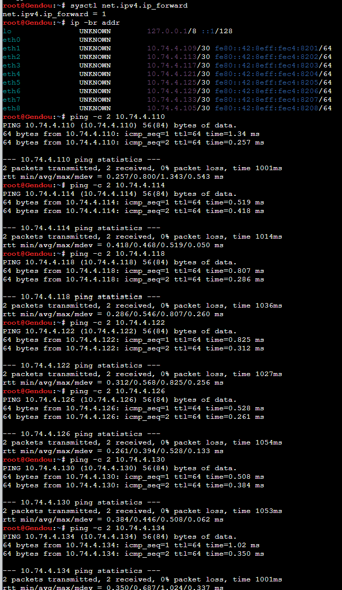 

- yui <br>
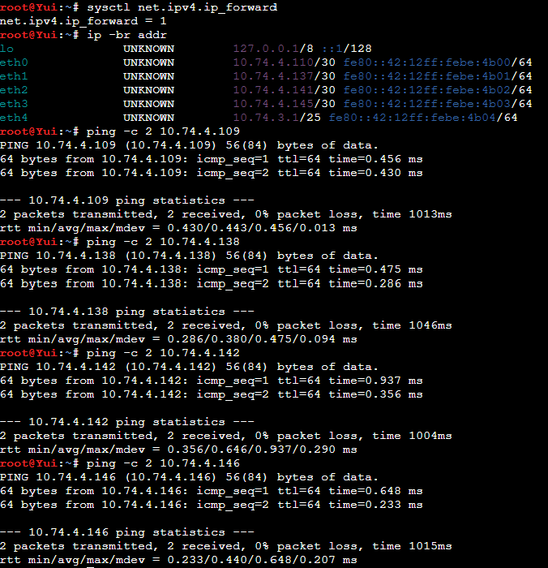

- hikari<br>
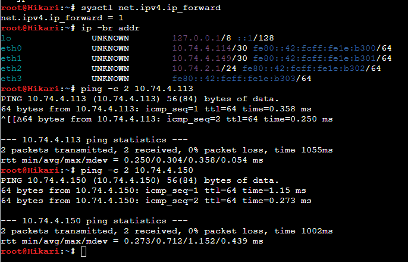
- asuka<br>
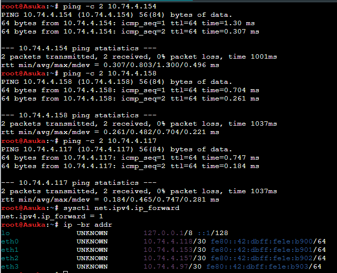

- misato<br>
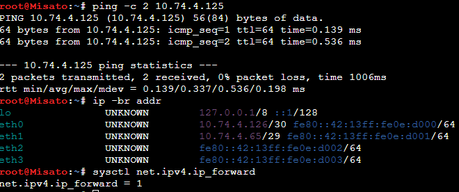

- shigeru<br>
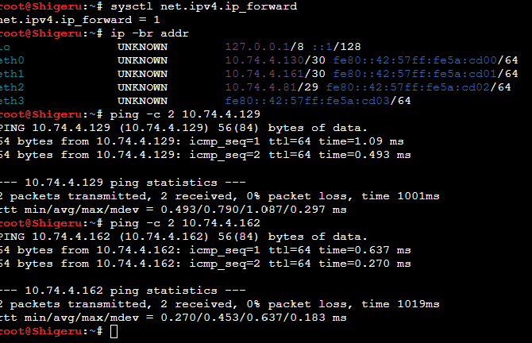

- fuyutsuki<br>
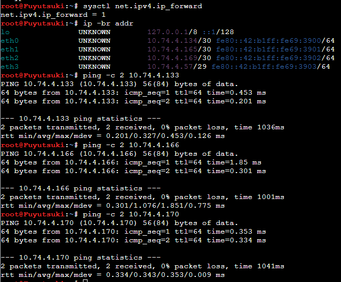

- shinji<br>
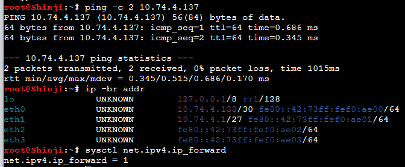

- rei<br>
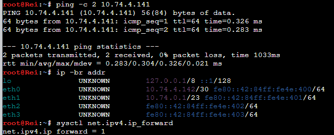

- mari<br>
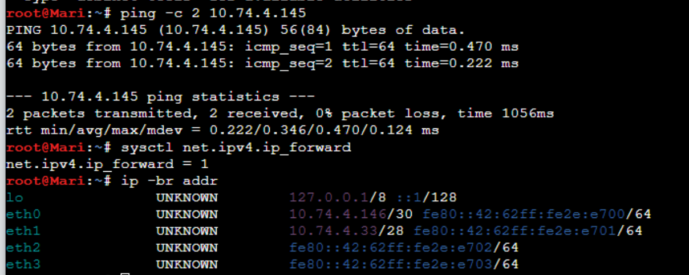

- kaworu<br>
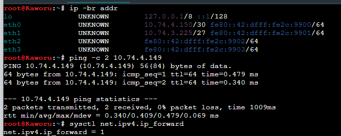

- kensuke<br>
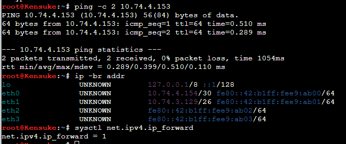

- ritsuko<br>
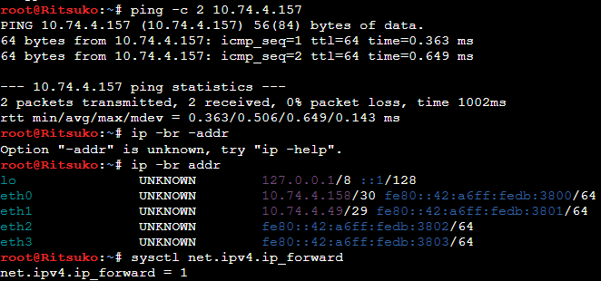

- makoto<br>
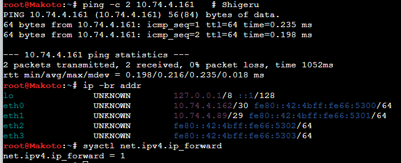

- toji<br>
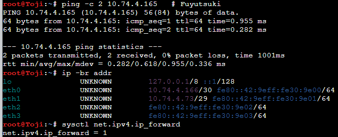

- maya<br>
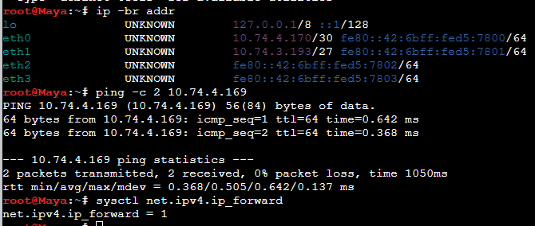

# SOAL 3
 Aturan:
- Router selain Gendou: **satu default route ke atas** + rute hanya untuk subnet di bawahnya.
- Gendou: default route ke NAT1 (didapat otomatis dari DHCP, **jangan ditulis manual**) + rute ke tiap cabang.
- Subnet dalam satu cabang yang bisa digabung **tepat** menjadi satu CIDR sudah diringkas.

## Perbarui config router

### Gendou
 
```
auto eth0
iface eth0 inet dhcp
  post-up sysctl -w net.ipv4.ip_forward=1
 
auto eth1
iface eth1 inet static
  address 10.74.4.109
  netmask 255.255.255.252
  up ip route add 10.74.0.0/23 via 10.74.4.110
  up ip route add 10.74.3.0/25 via 10.74.4.110
  up ip route add 10.74.4.0/27 via 10.74.4.110
  up ip route add 10.74.4.32/28 via 10.74.4.110
  up ip route add 10.74.4.136/29 via 10.74.4.110
  up ip route add 10.74.4.144/30 via 10.74.4.110
 
auto eth2
iface eth2 inet static
  address 10.74.4.113
  netmask 255.255.255.252
  up ip route add 10.74.2.0/24 via 10.74.4.114
  up ip route add 10.74.3.224/27 via 10.74.4.114
  up ip route add 10.74.4.148/30 via 10.74.4.114
 
auto eth3
iface eth3 inet static
  address 10.74.4.117
  netmask 255.255.255.252
  up ip route add 10.74.3.128/26 via 10.74.4.118
  up ip route add 10.74.4.48/29 via 10.74.4.118
  up ip route add 10.74.4.96/30 via 10.74.4.118
  up ip route add 10.74.4.152/29 via 10.74.4.118
 
auto eth4
iface eth4 inet static
  address 10.74.4.121
  netmask 255.255.255.252
  up ip route add 10.74.4.100/30 via 10.74.4.122
 
auto eth5
iface eth5 inet static
  address 10.74.4.125
  netmask 255.255.255.252
  up ip route add 10.74.4.64/29 via 10.74.4.126
 
auto eth6
iface eth6 inet static
  address 10.74.4.129
  netmask 255.255.255.252
  up ip route add 10.74.4.80/28 via 10.74.4.130
  up ip route add 10.74.4.160/30 via 10.74.4.130
 
auto eth7
iface eth7 inet static
  address 10.74.4.133
  netmask 255.255.255.252
  up ip route add 10.74.3.192/27 via 10.74.4.134
  up ip route add 10.74.4.56/29 via 10.74.4.134
  up ip route add 10.74.4.72/29 via 10.74.4.134
  up ip route add 10.74.4.164/30 via 10.74.4.134
  up ip route add 10.74.4.168/30 via 10.74.4.134
 
auto eth8
iface eth8 inet static
  address 10.74.4.105
  netmask 255.255.255.252
```
 
### Yui
 
```
auto eth0
iface eth0 inet static
  address 10.74.4.110
  netmask 255.255.255.252
  gateway 10.74.4.109
  post-up sysctl -w net.ipv4.ip_forward=1
 
auto eth1
iface eth1 inet static
  address 10.74.4.137
  netmask 255.255.255.252
  up ip route add 10.74.4.0/27 via 10.74.4.138
 
auto eth2
iface eth2 inet static
  address 10.74.4.141
  netmask 255.255.255.252
  up ip route add 10.74.0.0/23 via 10.74.4.142
 
auto eth3
iface eth3 inet static
  address 10.74.4.145
  netmask 255.255.255.252
  up ip route add 10.74.4.32/28 via 10.74.4.146
 
auto eth4
iface eth4 inet static
  address 10.74.3.1
  netmask 255.255.255.128
```
 
### Hikari
 
```
auto eth0
iface eth0 inet static
  address 10.74.4.114
  netmask 255.255.255.252
  gateway 10.74.4.113
  post-up sysctl -w net.ipv4.ip_forward=1
 
auto eth1
iface eth1 inet static
  address 10.74.4.149
  netmask 255.255.255.252
  up ip route add 10.74.3.224/27 via 10.74.4.150
 
auto eth2
iface eth2 inet static
  address 10.74.2.1
  netmask 255.255.255.0
```
 
### Asuka
 
```
auto eth0
iface eth0 inet static
  address 10.74.4.118
  netmask 255.255.255.252
  gateway 10.74.4.117
  post-up sysctl -w net.ipv4.ip_forward=1
 
auto eth1
iface eth1 inet static
  address 10.74.4.153
  netmask 255.255.255.252
  up ip route add 10.74.3.128/26 via 10.74.4.154
 
auto eth2
iface eth2 inet static
  address 10.74.4.157
  netmask 255.255.255.252
  up ip route add 10.74.4.48/29 via 10.74.4.158
 
auto eth3
iface eth3 inet static
  address 10.74.4.97
  netmask 255.255.255.252
```
 
### Kaji
 
```
auto eth0
iface eth0 inet static
  address 10.74.4.122
  netmask 255.255.255.252
  gateway 10.74.4.121
  post-up sysctl -w net.ipv4.ip_forward=1
 
auto eth1
iface eth1 inet static
  address 10.74.4.101
  netmask 255.255.255.252
```
 
### Misato
 
```
auto eth0
iface eth0 inet static
  address 10.74.4.126
  netmask 255.255.255.252
  gateway 10.74.4.125
  post-up sysctl -w net.ipv4.ip_forward=1
 
auto eth1
iface eth1 inet static
  address 10.74.4.65
  netmask 255.255.255.248
```
 
### Shigeru
 
```
auto eth0
iface eth0 inet static
  address 10.74.4.130
  netmask 255.255.255.252
  gateway 10.74.4.129
  post-up sysctl -w net.ipv4.ip_forward=1
 
auto eth1
iface eth1 inet static
  address 10.74.4.161
  netmask 255.255.255.252
  up ip route add 10.74.4.88/29 via 10.74.4.162
 
auto eth2
iface eth2 inet static
  address 10.74.4.81
  netmask 255.255.255.248
```
 
### Fuyutsuki
 
```
auto eth0
iface eth0 inet static
  address 10.74.4.134
  netmask 255.255.255.252
  gateway 10.74.4.133
  post-up sysctl -w net.ipv4.ip_forward=1
 
auto eth1
iface eth1 inet static
  address 10.74.4.165
  netmask 255.255.255.252
  up ip route add 10.74.4.72/29 via 10.74.4.166
 
auto eth2
iface eth2 inet static
  address 10.74.4.169
  netmask 255.255.255.252
  up ip route add 10.74.3.192/27 via 10.74.4.170
 
auto eth3
iface eth3 inet static
  address 10.74.4.57
  netmask 255.255.255.248
```
 
### Shinji
 
```
auto eth0
iface eth0 inet static
  address 10.74.4.138
  netmask 255.255.255.252
  gateway 10.74.4.137
  post-up sysctl -w net.ipv4.ip_forward=1
 
auto eth1
iface eth1 inet static
  address 10.74.4.1
  netmask 255.255.255.224
```
 
### Rei
 
```
auto eth0
iface eth0 inet static
  address 10.74.4.142
  netmask 255.255.255.252
  gateway 10.74.4.141
  post-up sysctl -w net.ipv4.ip_forward=1
 
auto eth1
iface eth1 inet static
  address 10.74.0.1
  netmask 255.255.254.0
```
 
### Mari
 
```
auto eth0
iface eth0 inet static
  address 10.74.4.146
  netmask 255.255.255.252
  gateway 10.74.4.145
  post-up sysctl -w net.ipv4.ip_forward=1
 
auto eth1
iface eth1 inet static
  address 10.74.4.33
  netmask 255.255.255.240
```
 
### Kaworu
 
```
auto eth0
iface eth0 inet static
  address 10.74.4.150
  netmask 255.255.255.252
  gateway 10.74.4.149
  post-up sysctl -w net.ipv4.ip_forward=1
 
auto eth1
iface eth1 inet static
  address 10.74.3.225
  netmask 255.255.255.224
```
 
### Kensuke
 
```
auto eth0
iface eth0 inet static
  address 10.74.4.154
  netmask 255.255.255.252
  gateway 10.74.4.153
  post-up sysctl -w net.ipv4.ip_forward=1
 
auto eth1
iface eth1 inet static
  address 10.74.3.129
  netmask 255.255.255.192
```
 
### Ritsuko
 
```
auto eth0
iface eth0 inet static
  address 10.74.4.158
  netmask 255.255.255.252
  gateway 10.74.4.157
  post-up sysctl -w net.ipv4.ip_forward=1
 
auto eth1
iface eth1 inet static
  address 10.74.4.49
  netmask 255.255.255.248
```
 
### Makoto
 
```
auto eth0
iface eth0 inet static
  address 10.74.4.162
  netmask 255.255.255.252
  gateway 10.74.4.161
  post-up sysctl -w net.ipv4.ip_forward=1
 
auto eth1
iface eth1 inet static
  address 10.74.4.89
  netmask 255.255.255.248
```
 
### Toji
 
```
auto eth0
iface eth0 inet static
  address 10.74.4.166
  netmask 255.255.255.252
  gateway 10.74.4.165
  post-up sysctl -w net.ipv4.ip_forward=1
 
auto eth1
iface eth1 inet static
  address 10.74.4.73
  netmask 255.255.255.248
```
 
### Maya
 
```
auto eth0
iface eth0 inet static
  address 10.74.4.170
  netmask 255.255.255.252
  gateway 10.74.4.169
  post-up sysctl -w net.ipv4.ip_forward=1
 
auto eth1
iface eth1 inet static
  address 10.74.3.193
  netmask 255.255.255.224
```
## Node uji dengan IP sementara
 
**Armisael** (Monolith, gateway 10.74.4.81):
```sh
ip addr add 10.74.4.86/29 dev eth0
ip link set eth0 up
ip route add default via 10.74.4.81
```
 
**Lilith** (Dogma, gateway 10.74.4.73):
```sh
ip addr add 10.74.4.78/29 dev eth0
ip link set eth0 up
ip route add default via 10.74.4.73
```
 
**Sachiel** (Bunker, gateway 10.74.3.129):
```sh
ip addr add 10.74.3.190/26 dev eth0
ip link set eth0 up
ip route add default via 10.74.3.129
```
 
**Comm-Net** (Comm, gateway 10.74.2.1):
```sh
ip addr add 10.74.2.254/24 dev eth0
ip link set eth0 up
ip route add default via 10.74.2.1
```
 
## Pembuktian 
 
Di **Armisael**:
```sh
ping -c 3 10.74.4.78     # Lilith
ping -c 3 10.74.3.190    # Sachiel
ping -c 3 10.74.2.254    # Comm-Net
```
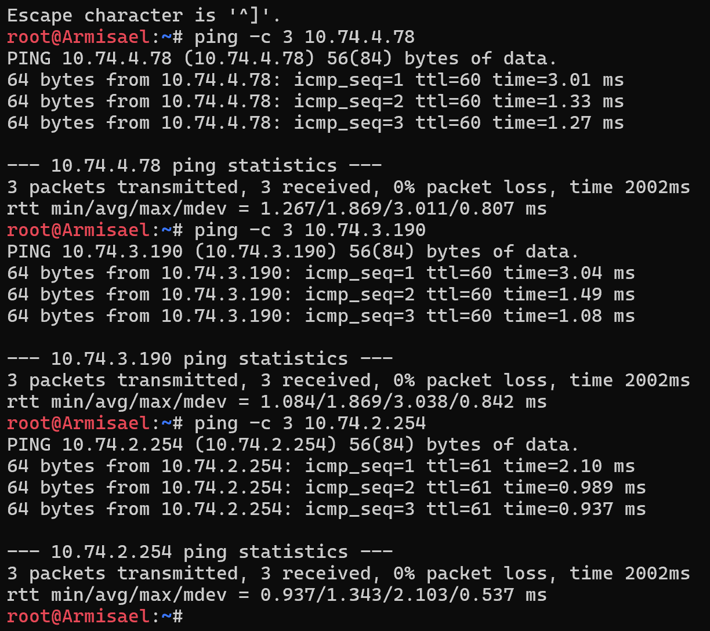
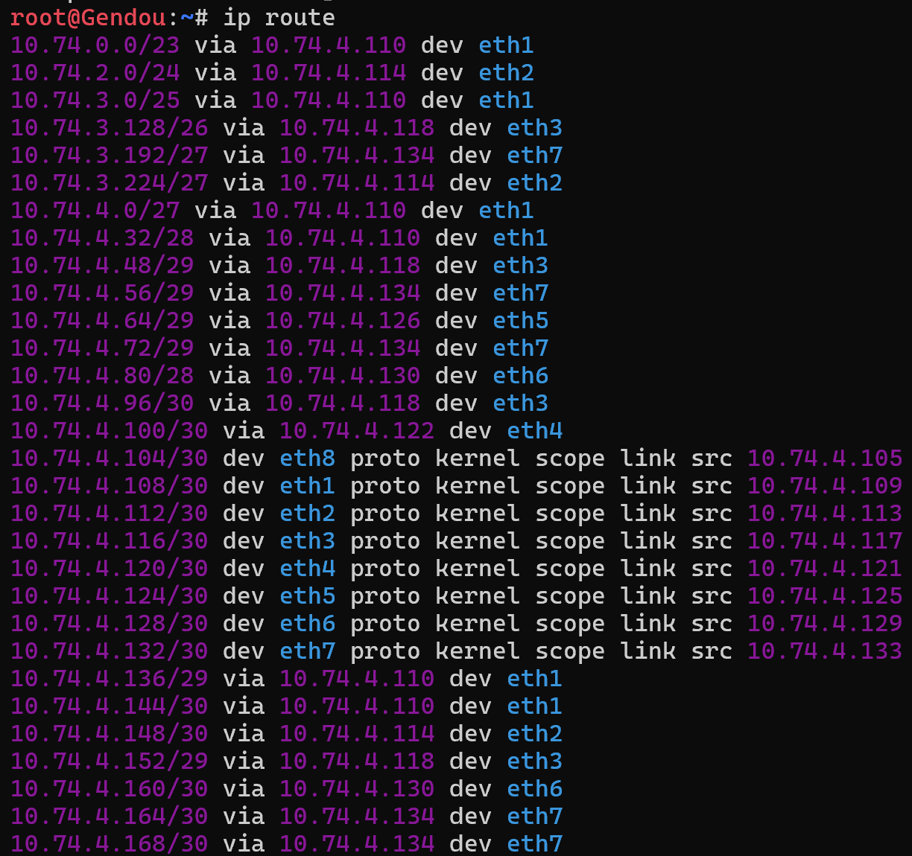
